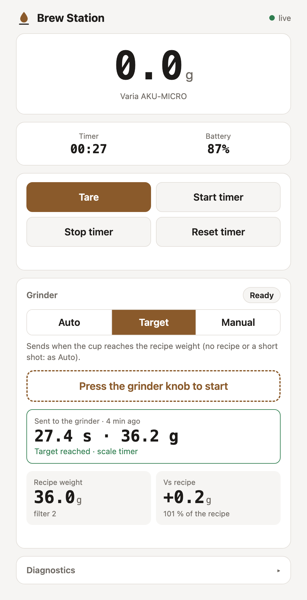
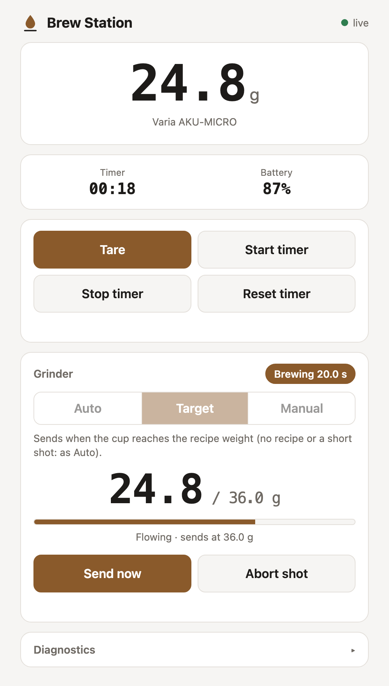
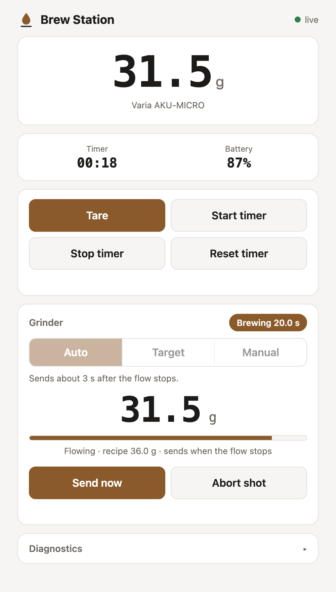
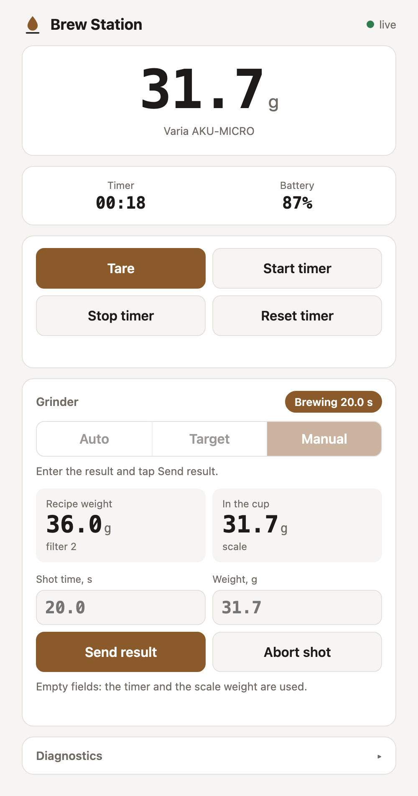
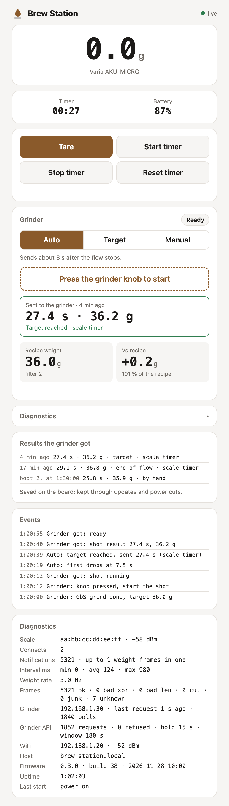
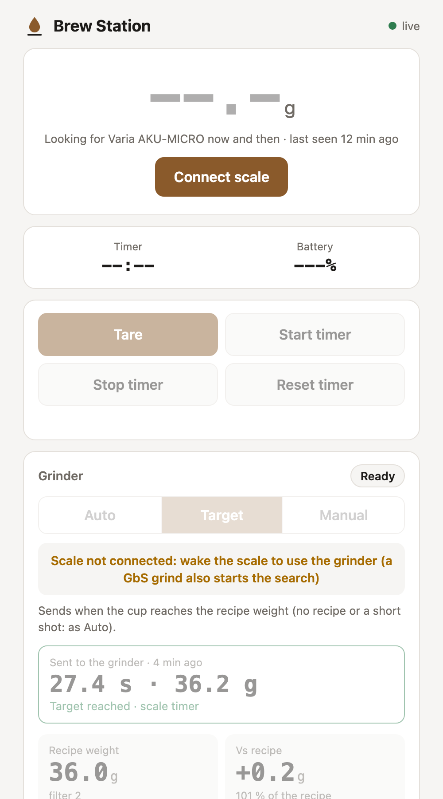

<p></p>

# Brew Station

Grind-by-Sync for a **Mahlkönig E64 WS** with a **Varia AKU** Bluetooth scale, on an ESP32-S3. No cloud, no Sync Scale.

The E64 WS adjusts its grind size from the time and weight of each shot. It normally gets those numbers from a connected espresso machine. Brew Station plays that machine on your local network, weighs the shot on the AKU over Bluetooth, and hands the grinder the result.

> **Not affiliated with Mahlkönig, Hemro, Varia, Xenia Espresso or La Marzocco.** Product names are used only to say what this works with. See [Disclaimer](#disclaimer).

## What it does

1. **Reads the AKU over Bluetooth LE** in real time: weight, battery, timer, tare and timer commands, and reconnects by itself when the scale sleeps and wakes. After a few minutes without the scale it looks less often to leave the radio to WiFi; a GbS grind, a knob press, opening the page or **Connect scale** makes it search non-stop again.
2. **Acts as the espresso machine** the E64 WS syncs with over plain HTTP on port 80 (the grinder's "Machine To Machine" setting).
3. **Finds the shot in the weight** and reports the extraction time and the beverage weight when the grinder asks, so it can adjust.

It does **not** control the espresso machine: you start and stop the shot yourself.

### A shot

1. You grind with Grind-by-Sync. The grinder sends its recipe weight to Brew Station.
2. You press the grinder's knob to start brewing. Brew Station tares the scale and starts its timer, which is your cue to start the machine.
3. Brew Station watches the weight and reports the time and weight according to the report mode:

| Mode | Sends the result | Time | Weight |
|---|---|---|---|
| **Auto** | about 3 s after the flow stops | knob press → end of flow | final weight in the cup |
| **Target** | as soon as the cup reaches the recipe weight (the rest of the pour is ignored; with no recipe weight or a short shot it works as Auto) | knob press → target reached | the weight at that moment |
| **Manual** | when you tap *Send result* on the page | what you enter (empty: timer and scale) | same |

The grinder ignores shots of 10 s or less and over 80 s, as it does with a real machine.

### Status page

Open `http://brew-station.local/` (or the board's IP). It shows the live weight, timer and battery, a switch for the report mode, the shot as it runs (with *Send now* and *Abort shot*), what was last sent to the grinder, and a Diagnostics section. Diagnostics lists the last 12 results the grinder actually got (saved in flash, kept through updates and power cuts) and the recent events, including what each grinder poll saw.

<table>
  <tr>
    <td align="center"><br><sub>Ready, waiting for the knob press</sub></td>
    <td align="center"><br><sub>Brewing, Target mode</sub></td>
    <td align="center"><br><sub>Brewing, Auto mode</sub></td>
  </tr>
  <tr>
    <td align="center"><br><sub>Manual mode</sub></td>
    <td align="center"><br><sub>Diagnostics</sub></td>
    <td align="center"><br><sub>Scale asleep, Connect scale</sub></td>
  </tr>
</table>

<sub>Screenshots use sample data.</sub>

## Hardware

- **Prototype board:** Wemos/LOLIN S3 Mini (ESP32-S3FH4R2, 4 MB flash, 2 MB PSRAM, native USB). Board-specific code is in `components/board/`.
- **Scale:** Varia AKU (tested with an AKU Micro).
- **Grinder:** Mahlkönig E64 WS only (2.4 GHz WiFi). E65/E80 and other grinders are out of scope.

## Build and flash

Requires [ESP-IDF 5.5](https://docs.espressif.com/projects/esp-idf/en/v5.5/esp32s3/get-started/).

```bash
. ~/esp/esp-idf-v5.5/export.sh
idf.py menuconfig        # Brew Station menu: WiFi, hostname, fixed IP, OTA token, modes
idf.py -p /dev/cu.usbmodem101 build flash
```

`sdkconfig` holds your WiFi password and OTA token. It is git-ignored: keep it that way.

The board's port name differs per computer (`/dev/ttyACM0` on Linux, `COMx` on Windows). If flashing can't connect, hold **BOOT**, tap **RST**, release **BOOT**, and try again.

### Updates over WiFi

After one USB flash, set an OTA token in menuconfig (Brew Station → Firmware update over WiFi) and update with:

```bash
idf.py build
tools/ota.sh 192.168.1.20      # or leave out the address to use <hostname>.local
```

A new firmware that can't get WiFi up within 120 s rolls back by itself. Updates are refused while a shot is running.

## Grinder setup

1. Give the board a **fixed IP**: a DHCP reservation in your router, or *Fixed IP address* in menuconfig.
2. On the E64 WS: **Connectivity → Machine To Machine → Enable Xenia**, and enter the board's IP.
3. Open the status page: the Grinder card shows a warning until the grinder's first request arrives.

## Settings (menuconfig → Brew Station)

| Setting | Default |
|---|---|
| WiFi SSID / password | – |
| Hostname (mDNS) | `brew-station` |
| Fixed IP, netmask, gateway, DNS | DHCP |
| Reboot after WiFi has been down for | 60 s |
| OTA token | empty (updates over WiFi off) |
| Finishing hold (how long a result stays up for the grinder) | 15 s (3–60); also held until a grinder poll has picked the result up |
| Scale search after the scale goes away | non-stop for 5 min, then 3 s every 30 s (0 = stop until woken) |
| Shot window (abort a shot with no result after) | 180 s |
| Tare and restart the scale timer on the knob press | on |
| Report mode before one is picked on the page | Auto |
| Shot time | from the knob press (or: from the first drops plus pre-infusion seconds) |

## Project layout

| Path | What |
|---|---|
| `components/aku/` | NimBLE central for the AKU: scan, connect, frame parsing, commands |
| `components/machine/` | The machine the grinder syncs with, as a pure state machine plus its JSON (host-testable) |
| `components/grinder_api/` | The grinder's HTTP API on port 80 |
| `components/shot/` | Shot detector and report decisions (pure C, host-testable) |
| `components/autoshot/` | Connects the scale, the detector and the machine; report modes |
| `components/web/` | Status page, WebSocket push, control API |
| `components/net/`, `ota/`, `board/` | WiFi + mDNS + watchdog, updates over WiFi, board pins |
| `test/host/` | Unit tests that run on your computer |

### Tests

```bash
cmake -S test/host -B build-host && cmake --build build-host && ctest --test-dir build-host
```

The machine tests use a port of gbs-anywhere's grinder model as the oracle. The detector tests are ported from gbs-anywhere and add shots replayed at the AKU's reading rate.

## Credits

Brew Station stands on the work of these projects. Protocol details and the shot logic were taken from them, with file and line references in the code.

| Project | License | Used for |
|---|---|---|
| [Skamba/gbs-anywhere](https://github.com/Skamba/gbs-anywhere) | AGPL-3.0 | The grinder's machine protocol, the machine state machine, request filtering, the weight-based shot detector and the grinder model used in tests (ported from Rust) |
| [gaggimate/esp-arduino-ble-scales](https://github.com/gaggimate/esp-arduino-ble-scales) | MIT, © kstam | Varia AKU UUIDs, frame parsing, checksum and tare (ported from NimBLE-Arduino) |
| [hallge/Brew-Controller](https://github.com/hallge/Brew-Controller) | AGPL-3.0 | AKU tare and timer commands (start, stop, reset) |
| [zpmdd/gbs-anywhere-esp32](https://github.com/zpmdd/gbs-anywhere-esp32) | AGPL-3.0 | ESP-IDF patterns (HTTP server, NimBLE, OTA, NVS) |

Built with [ESP-IDF](https://github.com/espressif/esp-idf) (Apache-2.0), NimBLE (Apache-2.0) and cJSON (MIT).

## License

**GNU Affero General Public License v3.0 or later** ([LICENSE](LICENSE)). Parts of the code are ported from AGPL-licensed projects (above), so the whole project is AGPL: you may use, fork and change it, but if you distribute it, or run a changed version for others over a network, you must publish your full source under the same license and keep the copyright and attribution notices.

## Disclaimer

This is an independent hobby project. It is **not affiliated with, endorsed by or supported by Mahlkönig, Hemro Group, Varia, Xenia Espresso, La Marzocco or any other manufacturer**. Mahlkönig, E64 WS, Grind-by-Sync, Varia, AKU, Xenia and other names are trademarks of their respective owners and are used only to describe compatibility.

It talks to your grinder and scale through their local interfaces, the same way a compatible machine or app would, but it was not tested or approved by their makers. Use it at your own risk. It does not control the espresso machine.
